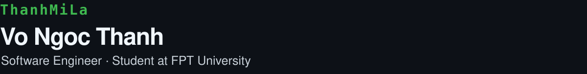
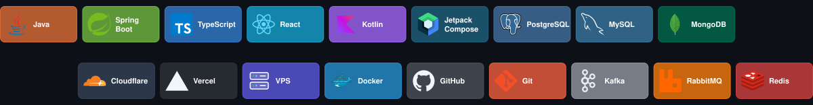
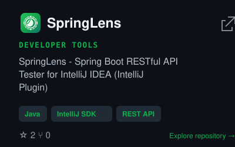
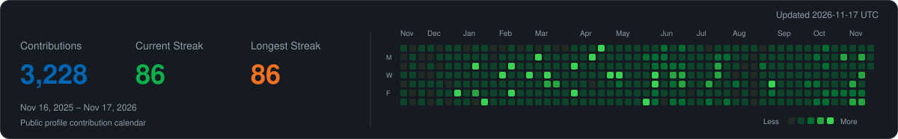
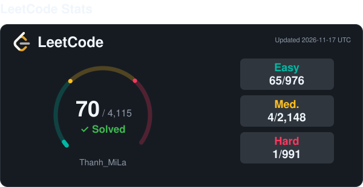
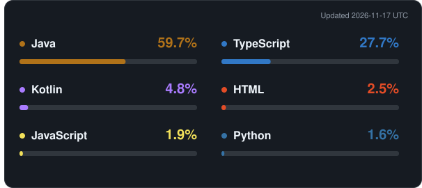

### Tech Stack

<h3>
  
  Featured Projects
</h3>

  
  
  

### GitHub Contributions

<table>
  <tr>
    <td width="50%"><strong>LeetCode Stats</strong></td>
    <td width="50%"><strong>Top 6 Languages</strong></td>
  </tr>
  <tr>
    <td width="50%"></td>
    <td width="50%"></td>
  </tr>
</table>

### Contact Me

  
  
  
  

